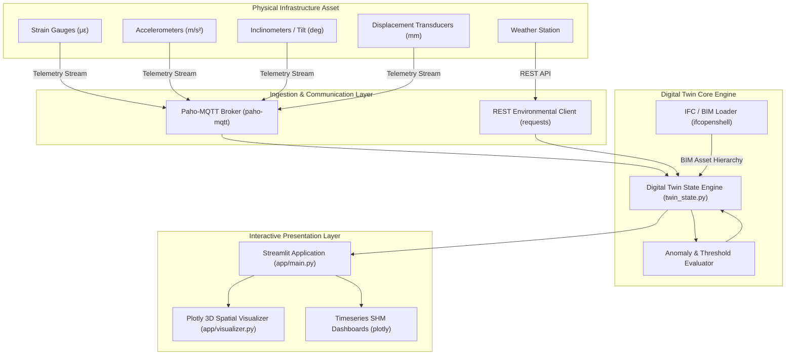

# Infrastructure Digital Twin Architecture

## System Overview

The **Infrastructure Digital Twin** platform bridges physical civil assets (bridges, viaducts, tunnels, dams, highway corridors) with high-fidelity digital representations by fusing **Building Information Modeling (BIM / IFC)** with **real-time Internet of Things (IoT / SCADA) telemetry**.

## Modular Layer Breakdown

### 1. Model Layer (`/models`)
* **`ifc_loader.py`**:
  * Utilizes `ifcopenshell` to ingest IFC2x3, IFC4, and IFC4x3 infrastructure models.
  * Extracts structural entities (`IfcBeam`, `IfcColumn`, `IfcSlab`, `IfcBridge`, etc.), property sets (Psets), and geometry.
  * Supplies a synthetic civil viaduct generator for out-of-the-box evaluation without external files.
* **`twin_state.py`**:
  * Represents structural elements as `TwinElement` instances with spatial coordinates, bounding geometry, health metrics, and bound sensors.
  * Computes overall asset Structural Health Index (SHI) and tracks historical anomaly logs.

### 2. Sensor Layer (`/sensors`)
* **`mqtt_client.py`**:
  * Thread-safe MQTT client built with `paho-mqtt` supporting MQTT v3.1.1 and v5.0.
  * Listens to hierarchical topic trees (`twin/infrastructure/viaduct/#`) and decodes JSON telemetry.
* **`simulator.py`**:
  * Simulates realistic structural response incorporating traffic loads, thermal baseline drift, micro-vibrations, and dynamic live loads.
  * Includes an anomaly injection mode to stress-test warning and critical alarm thresholds.
* **`api_client.py`**:
  * Connects to external REST APIs using `requests` to fetch ambient temperature, humidity, and wind load conditions.

### 3. Application Layer (`/app`)
* **`main.py`**:
  * Streamlit web application providing tabs for 3D spatial inspection, real-time sensor analytics, BIM inventory audit, and alarm acknowledgments.
* **`visualizer.py`**:
  * Interactive 3D scene rendered in Plotly featuring 3D bounding geometry, health color heatmaps, and sensor node pins.
  * 2D timeseries graphs with configurable threshold limit lines.
* **`components.py`**:
  * Custom dark-mode UI styling and KPI metric cards.
